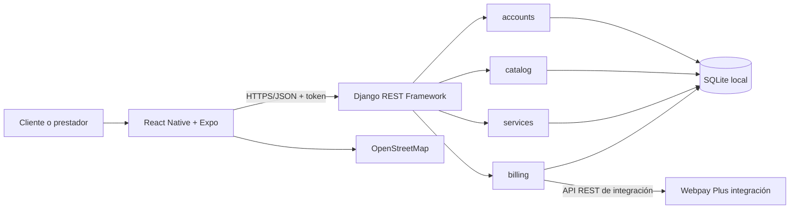
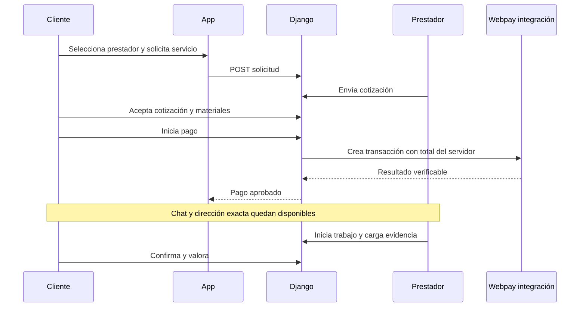

# Arquitectura de FIX&GO

## Modelo arquitectónico

FIX&GO adopta un monolito modular con una API REST y un cliente móvil multiplataforma. Para un equipo de tres estudiantes y un MVP local, este modelo reduce despliegues, contratos distribuidos y fallos operativos, mientras conserva separación por dominios. La arquitectura puede migrar posteriormente a PostgreSQL y servicios administrados sin cambiar el contrato principal de la aplicación.

## Responsabilidades

- `mobile`: vistas, navegación, formularios, mapa y comunicación con la API. Conserva el token en SecureStore en dispositivos y en memoria para la vista web.
- `accounts`: usuarios, roles, perfil del prestador, autenticación y datos reutilizables del cliente.
- `catalog`: categorías, comunas y consulta geográfica de prestadores.
- `services`: solicitudes, cotizaciones, estados, valoraciones, panel del prestador y evidencias.
- `billing`: materiales, orden de pago, Webpay de integración, chat, comprobante, reclamos, reembolsos y alertas.
- `core`: salud del servidor, paginación, excepciones y controles transversales.

La API es la autoridad para permisos, estados, precios y acceso a datos privados. La interfaz no puede aprobar pagos, asignar roles ni alterar importes mediante campos ocultos. Las acciones críticas se validan por pertenencia y rol.

## Modelo de datos

El usuario tiene rol cliente o prestador; el prestador extiende sus datos mediante `ProviderProfile`. Una `ServiceRequest` vincula cliente, prestador, categoría y comuna. Puede tener cotizaciones históricas, una orden de pago, materiales, mensajes, fotografías, valoración y reclamo.

La orden congela el precio acordado y materiales aprobados. Cada intento Webpay utiliza una orden de compra y token únicos; no almacena tarjeta, CVV ni clave bancaria. Un reclamo tiene revisión administrativa; si corresponde una devolución, genera a lo sumo una alerta asociada al prestador.

El diagrama completo de entidades y relaciones orientado a clases está en [UML de clases](04_UML_CLASES.md). Las migraciones Django incluidas en `FIX_AND_GO_SOFTWARE/backend/*/migrations` constituyen el esquema ejecutable y auditable.

## Flujo principal

## Decisiones y límites

- SQLite es apropiado para demostración local y baja concurrencia. Producción requiere PostgreSQL, backups y observabilidad.
- Expo permite demostrar web, iOS y Android desde una base TypeScript. La exportación de bundles no reemplaza pruebas en dispositivos físicos.
- OpenStreetMap/Leaflet evita costos de licencia iniciales; requiere atribución e Internet para teselas.
- Webpay usa únicamente el ambiente de integración. Los cobros, comprobantes y reembolsos no mueven dinero real.
- La dirección exacta del cliente se oculta al prestador hasta que el backend verifica el pago.
- El chat se abre tras el pago para reducir coordinación fuera de la plataforma; no puede garantizar que un usuario no escriba contactos en campos libres sin moderación adicional.

Los detalles de instalación, endpoints y operación están en el [manual técnico](../FIX_AND_GO_SOFTWARE/docs/MANUAL_TECNICO.md).
