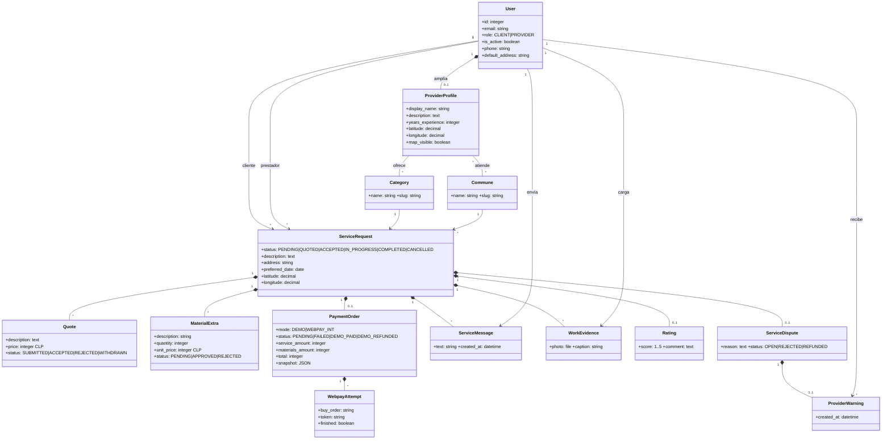

# Diagrama UML de clases — FIX&GO

El diagrama representa las entidades persistentes principales. Django agrega claves técnicas y metadatos internos que se consultan en las migraciones.

## Reglas estructurales relevantes

- Cada solicitud tiene como máximo una `PaymentOrder` y una `Rating`.
- Cada reclamo genera como máximo una `ProviderWarning`; repetir una resolución no duplica la alerta.
- Una orden conserva un snapshot para que el total histórico no cambie si luego se modifica un catálogo.
- Las relaciones con pagos, mensajes, evidencias y reclamos usan protección de historial; no se eliminan en cascada como solución operativa.
- El token Webpay es una capacidad de integración y se protege de registros; no representa ni contiene datos de tarjeta.

Fuente ejecutable del modelo: modelos y migraciones del directorio [`FIX_AND_GO_SOFTWARE/backend`](../FIX_AND_GO_SOFTWARE/backend/).
