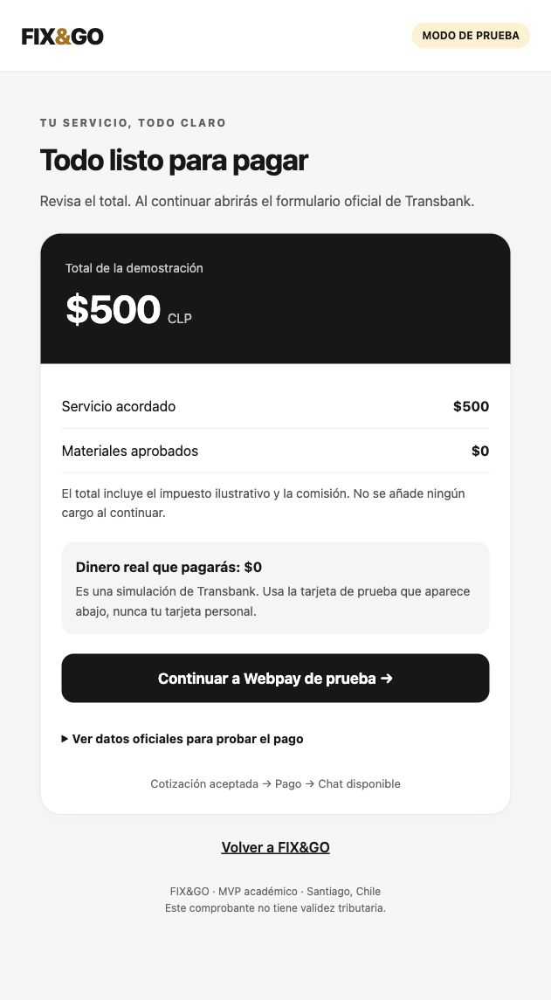
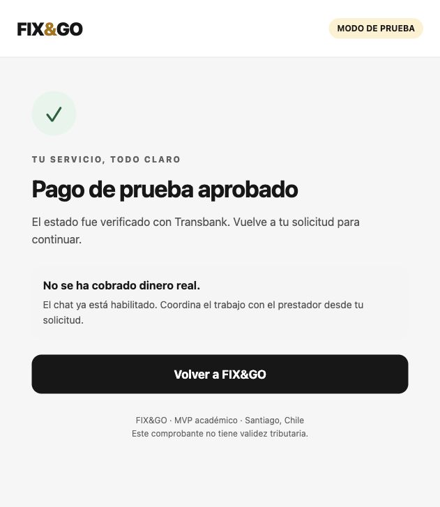

# FIX&GO · Flujo del MVP y pagos de prueba

Fecha de verificación: 4 de noviembre de 2026. Alcance: demostración académica local en Santiago, sin contratar trabajos ni cobrar dinero real.

## Recorrido y reglas

1. El cliente ingresa, indica una ubicación en Santiago y selecciona un prestador del mapa. Los marcadores son zonas de atención publicadas, no GPS en vivo.
2. Envía una solicitud con descripción y comuna. La dirección exacta y coordenadas permanecen ocultas al prestador hasta el pago, tanto en el detalle como en su panel de inicio.
3. El prestador cotiza. El cliente acepta o rechaza; aceptar no cobra dinero. Antes de la aceptación el prestador puede retirar la propuesta para corregirla.
4. Con la cotización aceptada, el prestador propone materiales. El cliente aprueba o rechaza cada uno. Cualquier adicional pendiente bloquea el pago.
5. El cliente revisa el resumen y abre Webpay de integración. Django calcula el total y congela el desglose: ningún importe enviado por el móvil puede cambiarlo.
6. Transbank recibe únicamente los datos técnicos de la transacción y su formulario aloja los campos de tarjeta. El backend comprueba estado AUTHORIZED, código 0, importe y orden de compra antes de aprobar el pago.
7. El chat y el inicio del servicio se habilitan solamente después de la confirmación. El detalle y la conversación abierta se actualizan cada cinco segundos mientras la aplicación está activa.
8. El prestador inicia el trabajo y carga fotografías privadas. El cliente no puede finalizar si no existe al menos una evidencia. La fotografía respalda la revisión; por sí sola no demuestra que un trabajo real se haya realizado correctamente.
9. El cliente confirma, valora y consulta el comprobante de demostración.
10. Un reclamo abre revisión administrativa. Solo una revisión fundada permite reembolsar y registrar una alerta. Tres alertas confirmadas deshabilitan al prestador, sin borrar su historial. El chat se cierra tras el reembolso.

La cancelación previa al pago también funciona después de aceptar una cotización. Si existe una sesión Webpay abierta, primero debe terminarse o anularse en el formulario para no cancelar una solicitud mientras el banco la procesa.

## Pantalla y experiencia de pago

- Fondo neutro, tarjeta de total negra, acento dorado y botones grandes, coherentes con FIX&GO.
- Servicio y materiales separados; impuestos ilustrativos y comisión en un desglose desplegable.
- Una acción principal para abrir el pago. El simulador sin Transbank queda como alternativa secundaria.
- Aviso explícito: **dinero real $0**. No ingresar tarjetas, RUT o claves reales en las pruebas.
- La pantalla propia y la de resultado pertenecen a FIX&GO. El formulario bancario posterior pertenece a Transbank y conserva su diseño oficial.
- La web conserva la sesión en memoria: después del pago vuelve a la pestaña original de FIX&GO. Abrir una nueva instancia puede pedir iniciar sesión de nuevo.



## Arquitectura de la integración

Se conserva Django REST Framework como monolito modular, SQLite local y React Native/Expo con TypeScript. No se añade un microservicio ni se duplica lógica financiera en el móvil.

`PaymentOrder` representa la única liquidación de una solicitud y conserva el snapshot del precio, materiales e impuesto ilustrativo. El modo distingue `DEMO` (simulador) de `WEBPAY_INT` (Transbank de integración). Los estados históricos `DEMO_PAID` y `DEMO_REFUNDED` se mantienen para no romper el contrato existente; **no son pagos reales**.

`WebpayAttempt` registra los intentos de una orden: identificador único de compra, token de integración y finalización. Nunca almacena PAN, CVV ni claves bancarias. Reabrir un intento pendiente lo reutiliza. Repetir un callback confirmado no vuelve a cobrar. Una reversa que ya confirmó Transbank se reconcilia sin volver a generar alertas.

| Ruta relativa a `/api/v1/` | Propósito |
|---|---|
| `POST requests/{id}/payment/webpay/` | Cliente propietario inicia o retoma la sesión de integración |
| `GET webpay/launch/` | Resumen FIX&GO y formulario de envío al dominio oficial de integración |
| `GET/POST webpay/return/` | Retorno, anulación o vencimiento; verificación servidor a servidor |
| `GET requests/{id}/billing/` | Total y estado autoritativos |
| `GET/POST requests/{id}/messages/` | Conversación privada, solo después del pago |
| `POST admin/disputes/{id}/review/` | Revisión autorizada y reversa de prueba cuando corresponde |

El callback no usa la sesión del navegador como prueba de pago. Tiene excepción CSRF por ser un retorno externo, pero requiere un intento conocido y verificación bancaria. El inicio exige autenticación, pertenencia y estado correcto. El simulador no puede aprobar una orden Webpay. Las páginas de pago envían `no-store`, política de referente y CSP; los registros del servidor redactan tokens de pago en URLs.

Las llamadas de red tienen un límite de 15 segundos. Ante fallo de confirmación se conserva el intento y se ofrece recargar la página. No se debe iniciar otra compra a ciegas. Webpay envía el vencimiento de su formulario mediante orden y sesión, sin token; también se maneja ese retorno. Si se cerró la pestaña, el botón para continuar abre el intento pendiente.

Para el MVP se conserva la serialización por solicitud en SQLite. Las operaciones bancarias mantienen el bloqueo mientras se verifican; antes de alta concurrencia comercial se requiere PostgreSQL y un proceso duradero de conciliación/reintentos que no dependa del retorno del navegador.

## Configuración local

En `backend/.env`, usando el formato de `.env.example`:

```dotenv
DJANGO_DEBUG=true
PAYMENTS_DEMO_ENABLED=true
WEBPAY_INTEGRATION_ENABLED=true
WEBPAY_RETURN_URL=http://localhost:8000/api/v1/webpay/return/
WEBPAY_APP_URL=http://localhost:8091/
CORS_ALLOWED_ORIGINS=http://localhost:8091
```

Conservar una `DJANGO_SECRET_KEY` local y no publicarla. Ejecutar desde `backend`:

```sh
python manage.py migrate
python manage.py runserver 127.0.0.1:8000
```

Desde `mobile`:

```sh
EXPO_PUBLIC_API_URL=http://localhost:8000 npx expo start --web --port 8091
```

El dominio bancario y las credenciales públicas son exclusivamente los de integración. Esta implementación no permite cambiar a producción mediante credenciales de comercio. Sin las banderas de demostración o con DEBUG desactivado, el inicio de pagos está bloqueado.

En teléfonos físicos, `localhost` apunta al teléfono. Configurar la IP LAN del Mac en la API y el callback, usar la misma red y autorizar solo esa red en la configuración local. No publicar el servidor de desarrollo en Internet. La prueba documentada se realizó en navegador web; falta la aceptación en dispositivos iOS y Android reales.

## Crear un servicio de prueba por $500

Con cuentas de demostración existentes, ejecutar:

```sh
python manage.py seed_payment_demo --client cliente.nov4@example.test --provider prestador.nov4@example.test
```

El comando crea una solicitud nueva, aceptada y cotizada en $500, sin cambiar precios anteriores ni reiniciar datos. Solo funciona con DEBUG y pagos de demostración habilitados. Estos correos corresponden a las cuentas ficticias usadas en la verificación local; en otra instalación se deben indicar los correos de sus cuentas demo.

Datos **ficticios oficiales** para el formulario Webpay:

| Campo | Valor de prueba |
|---|---|
| Visa | `4051885600446623` |
| CVV | `123` |
| Vencimiento | Una fecha futura, por ejemplo `11/28` |
| RUT del banco simulado | `11.111.111-1` |
| Clave del banco simulado | `123` |

Seleccionar «Aceptar» en el simulador bancario para la aprobación. La pantalla propia también muestra estos datos en una ayuda desplegable. Fuente: [Transbank, Cómo empezar](https://transbankdevelopers.com/documentacion/como_empezar).

## Pruebas ejecutadas y evidencia

- Backend: **82 pruebas aprobadas**, incluidos permisos, importes manipulados, cotizaciones, materiales, reintentos, chat, fotos, reclamos y devolución.
- Mobile: **12 pruebas aprobadas** y `tsc --noEmit` sin errores.
- Exportación Expo de bundles web, iOS y Android completada. Esto comprueba empaquetado, no funcionamiento en hardware ni publicación en tiendas.
- Migraciones: `makemigrations --check --dry-run`, sin cambios pendientes.
- En navegador, servicio de $500: formulario oficial de Transbank → banco simulado → retorno aprobado → chat habilitado automáticamente. **Sin dinero real.**
- Contra la API local y la misma transacción: respuesta del prestador → inicio → cierre bloqueado sin fotografía (409) → foto sintética → lectura privada → cierre del cliente → valoración → comprobante de $500. Nueve comprobaciones satisfactorias.
- Reversa contra Transbank de integración: devolución de los $500 ficticios, estado local `DEMO_REFUNDED`, repetición sin nueva devolución ni segunda alerta.



Comandos de regresión:

```sh
# backend
python manage.py test --noinput
python manage.py makemigrations --check --dry-run
# mobile
npm run typecheck
npm test
npx expo export --platform all
```

## Guion de QA manual

| Caso | Acción | Resultado esperado |
|---|---|---|
| Antes del pago | Cliente acepta cotización; prestador abre detalle | Chat bloqueado y dirección exacta oculta |
| Material pendiente | Proponer un material e intentar pagar | Se exige aprobar o rechazar antes de continuar |
| Aprobación | Pagar servicio de $500 con datos ficticios oficiales | Total $500 en ambos sistemas; cobro real $0; chat habilitado |
| Rechazo | En otra solicitud, elegir Rechazar en banco simulado | Sin chat ni inicio; opción de reintento |
| Anulación | Elegir Anular compra y volver en Webpay | No aprobar; poder cancelar la solicitud o reintentar |
| Vencimiento | Dejar vencer el formulario y regresar | No aprobar; intento finalizado, reintento disponible |
| Retorno repetido | Recargar resultado aprobado | Una orden y mismo resultado, sin cobro adicional |
| Conversación | Cliente y prestador envían mensajes desde sesiones distintas | Cada parte ve mensajes y actualizaciones sin recargar la página |
| Evidencia | Iniciar servicio; cliente intenta finalizar antes y después de subir foto | Sin foto se bloquea; con foto puede confirmar |
| Valoración | Valorar como cliente y repetir | Una valoración; no se duplica |
| Reclamo | Abrir reclamo y revisarlo como administrador | No sancionar por denuncia sola; resolución fundada; reversa y alerta si se confirma |
| Reembolso | Repetir resolución REFUND | No duplicar devolución ni alerta; chat cerrado |
| Privacidad | Intentar leer solicitudes, fotos o chat como tercero | Acceso denegado; sin datos privados |

## Decisiones para el piloto en Chile

La app explica su carácter académico antes del acceso y en Información, identifica al equipo y restringe el piloto a datos ficticios. Informa precio total, comisión del 30% sobre servicio (sin comisión de materiales), alcance del mapa, uso de fotos y procedimiento de reclamos. No promete boletas fiscales, seguros, custodia bancaria o transferencias a prestadores. Las condiciones no eliminan derechos del consumidor.

Esto es una implementación técnica para el piloto, **no una certificación legal ni autorización para operar comercialmente**. Antes de usuarios y cobros reales deben definirse razón social/responsable, contacto formal, tratamiento tributario, condiciones y privacidad revisadas, derechos de los titulares, retención/eliminación, comprobantes fiscales y contrato de comercio. La tasa del 19% es ilustrativa y no decide obligaciones tributarias.

La Ley 21.719 entra en vigencia el 1 de diciembre de 2026; la preparación comercial debe considerar ese cambio. Fuentes oficiales consultadas:

- Transbank. (s. f.). [Webpay Plus: integración, confirmación, anulación y vencimiento](https://transbankdevelopers.com/documentacion/webpay-plus).
- Transbank. (s. f.). [Cómo empezar: credenciales y tarjetas de integración](https://transbankdevelopers.com/documentacion/como_empezar).
- SERNAC. (s. f.). [Reglamento de Comercio Electrónico](https://www.sernac.gob.cl/portal/604/w3-article-65050.html).
- Biblioteca del Congreso Nacional de Chile. (2024). [Ley 21.719, protección y tratamiento de los datos personales](https://www.bcn.cl/leychile/Navegar?idNorma=1209272&idParte=10527471&idVersion=2026-12-01).

## Límites pendientes para producción

No están habilitados cobros reales, tarjetas bancarias guardadas mediante Oneclick, transferencias al prestador, publicación en tiendas ni emisión de boletas fiscales. La billetera de prueba sigue siendo ficticia y no se utiliza como una tarjeta tokenizada real en Webpay. Tampoco se garantiza impedir contactos escritos en campos libres: se ocultan canales directos y se condiciona el chat, pero falta moderación para un lanzamiento público.

Monitorear respuestas 409/503, intentos pendientes, reembolsos, errores de fotos, latencia y bloqueos de SQLite. No registrar tokens, números de tarjeta, RUT ni claves. Completar pruebas físicas iOS/Android, accesibilidad con usuarios mayores, carga, restauración de respaldos, conciliación bancaria y revisión jurídica antes de un piloto comercial.
