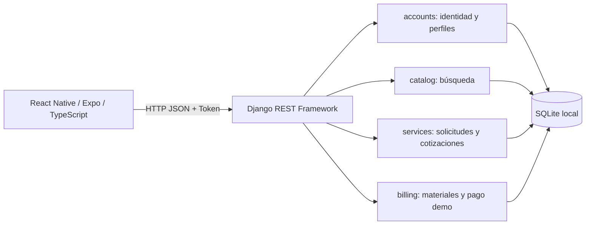

# Backend FIX&GO y conexión con la app

Actualización: 20 de octubre de 2026. Alcance: MVP académico local con cobro final de demostración. Este documento describe el código entregado, no una pasarela bancaria futura.

## 1. Arquitectura y responsabilidades



Django 5.2 y DRF 3.16 ejecutan una API monolítica dividida por dominio. La app Expo 57 comparte el mismo cliente HTTP para iOS, Android y web. Python gestiona validaciones, autorizaciones, transacciones y persistencia; TypeScript describe contratos y estados de pantalla.

El monolito permite a un solo desarrollador implementar cambios de datos y negocio con transacciones locales sin desplegar microservicios ni pagar infraestructura. SQLite mantiene la demo en el Mac. Es adecuado para la demostración de baja concurrencia; no constituye una validación de carga productiva. Un despliegue real requeriría HTTPS, servidor de aplicación, configuración segura, respaldo persistente y evaluación de PostgreSQL.

`config/urls.py` reúne las rutas bajo `/api/v1/`. Las vistas verifican autenticación y serializan entradas/salidas. `services/workflow.py` y `billing/workflow.py` concentran decisiones de estado. Los modelos y las migraciones definen el esquema. No hay acceso SQL directo desde React Native.

## 2. Modelo y relaciones

| Entidad | Responsabilidad y relación |
|---|---|
| `accounts.User` | Identidad Django; email único sin distinguir mayúsculas, contraseña con hash y rol CLIENT/PROVIDER. Guarda teléfono, dirección y comuna habitual privada. |
| `ProviderProfile` | Perfil profesional uno a uno con User. Nombre visible, experiencia, categorías y comunas mediante relaciones muchos a muchos. |
| `Category`, `Commune` | Catálogos de servicios y cobertura territorial. |
| `ServiceRequest` | Une cliente, prestador, categoría y comuna. Conserva descripción, dirección del servicio y estado. |
| `Quote` | Cotizaciones del prestador asociado; historial y restricción de cotización activa por solicitud. Precio total CLP entero y positivo. |
| `Rating` | Una valoración por solicitud terminada; puntaje entre 1 y 5, también protegido por restricción de base de datos. |
| `MaterialExtra` | Muchos por solicitud; descripción, cantidad, precio unitario total, decisión y fecha de decisión. |
| `PaymentOrder` | Uno a uno con solicitud: evita duplicar liquidaciones. Totales, desglose ilustrativo, snapshot JSON, estado y fecha de aprobación demo. |
| `ServiceMessage` | Muchos por solicitud; usuario emisor, texto y fecha. Lectura/escritura solo para participantes después del pago demo. |

Las nuevas migraciones son `accounts/0004`, `services/0003` y `billing/0001`. `migrate` aplica estos cambios sin recrear la base. Antes de migrar datos existentes debe existir un respaldo. Las restricciones de puntuación pueden impedir la migración si hay registros anteriores fuera del rango permitido: eso exige corregir el dato, no eliminar la restricción.

`MaterialExtra`, `PaymentOrder` y `ServiceMessage` usan `PROTECT` en la referencia a la solicitud para conservar el historial. Por ese motivo, el comando de reinicio de la demo rechaza eliminar usuarios con esos registros asociados. No hay borrado de liquidaciones por API.

## 3. Identidad, perfil y datos que se reutilizan

1. Registro crea usuario, perfil profesional cuando corresponde y token en una transacción. Si una operación falla, no queda una cuenta parcial.
2. Inicio de sesión recibe email y contraseña; Django comprueba el hash. La rotación de tokens vencidos usa una transacción y bloqueo de escritura.
3. Cada petición protegida envía `Authorization: Token <token>`. Un token vence a las 24 horas, salvo cambio de configuración.
4. `GET /auth/me/` devuelve solo el perfil propio. `PATCH /auth/me/` permite nombre, apellido, teléfono, dirección y comuna habitual. No permite cambiar rol, privilegios ni introducir campos de tarjetas.
5. Al guardar el perfil, React actualiza `session.user`. `NewRequest` precarga dirección y, si está cubierta por el prestador, la comuna habitual. La dirección de una solicitud queda como dato de esa solicitud; cambiar el perfil no cambia trabajos anteriores.
6. Expo SecureStore conserva el token en Keychain/Keystore. En navegador se conserva en memoria y una recarga exige ingresar nuevamente. Al cerrar sesión se revoca en Django y se limpia localmente; si no hay red, se limpia localmente pero el token remoto permanece hasta revocación/expiración.

La dirección del trabajo se comparte con el prestador asignado. El teléfono personal no aparece en el catálogo; no se exige un RUT ni se incorporan los RUT académicos del equipo al código, fixtures o pruebas.

## 4. Estados y flujo de negocio

```text
PENDING → QUOTED → ACCEPTED → IN_PROGRESS → COMPLETED
    └────────┴→ CANCELLED
QUOTED → PENDING al rechazar o retirar una cotización
```

El cliente solicita a un prestador activo con cobertura de categoría y comuna. El prestador cotiza; el cliente acepta o rechaza. Solo el prestador inicia el trabajo. Cualquiera de las dos partes puede marcarlo completado una vez iniciado, de acuerdo con el contrato existente del MVP. El cliente puede valorar el servicio completado, independientemente de si ya ejecutó la simulación de pago.

Las transiciones utilizan operaciones condicionales y transacciones; repetir una aceptación o una transición ya realizada no debe generar nuevos registros. Las acciones incompatibles responden 409. No se cancela después de aceptar en este alcance; disputas/reembolsos requieren un flujo futuro explícito.

Los materiales pueden proponerse desde ACCEPTED, durante IN_PROGRESS o tras COMPLETED mientras no exista liquidación. Solo el prestador asignado los crea. Solo el cliente asociado decide APPROVED o REJECTED. La decisión es definitiva: repetir la misma es idempotente y cambiarla devuelve 409. Una propuesta equivocada debe rechazarse y reemplazarse por otra antes del checkout.

## 5. Cálculo y cobro final de demostración

Se implementó la modalidad elegida: **un cobro final al terminar**, con materiales previamente aprobados. No se implementó un adelanto ni dos cobros.

```text
total = precio de cotización aceptada
      + suma(cantidad × precio unitario de materiales APPROVED)
```

Un material PENDING bloquea el checkout hasta que el cliente lo apruebe o rechace. El backend rechaza montos o estados enviados como campos de checkout. Todos los importes son enteros CLP; cantidades 1–10.000, precio unitario 1–100.000.000 y total máximo 2.147.483.647. La aritmética del impuesto ilustrativo usa `Decimal` y redondeo `ROUND_HALF_UP`.

Los precios ya incluyen el impuesto de demostración; no se añade otra vez. Para una cotización de $35.000 y dos materiales de $2.500, total $40.000. Con tasa demo 19%, neto $33.613 e impuesto $6.387. La tasa es ilustrativa y no determina la obligación tributaria de un prestador.

`checkout` adquiere un bloqueo de escritura sobre la solicitud antes de leer datos. En SQLite se hace mediante un `UPDATE` dentro de `transaction.atomic`; `select_for_update` por sí solo no bloquearía filas en SQLite. Materiales y checkout usan el mismo protocolo para evitar que cambien importes mientras se congela la orden. La restricción uno a uno constituye una segunda defensa contra duplicados.

La orden guarda una copia de descripción y materiales aprobados. Desde ese punto los materiales quedan congelados incluso si el pago demo es rechazado. Repetir checkout devuelve la misma orden. Un rechazo puede reintentarse; una aprobación confirmada no se revierte a FAILED.

```text
Sin orden → PENDING → DEMO_PAID
                    ↘ FAILED → DEMO_PAID
```

Solo `DEBUG=true` junto con `PAYMENTS_DEMO_ENABLED=true` habilitan checkout y resultado demo. En otras configuraciones ambas mutaciones fallan con 403. `DEMO_PAID` significa una simulación explícita y nunca debe interpretarse como dinero recibido. No hay adaptador real, webhook de banco ni un estado PAID real.

El comprobante incluye servicio, materiales, neto, impuesto ilustrativo y total. Es JSON visualizado por la app, rotulado sin validez tributaria; no es una boleta SII ni un PDF fiscal. No se guardan números de tarjeta, CVV o credenciales bancarias.

## 6. Contrato HTTP

Todas las rutas siguientes son relativas a `/api/v1/`, terminan en `/` y requieren token salvo registro, login, health y catálogos básicos.

| Método y ruta | Quién / comportamiento |
|---|---|
| `POST auth/register/`, `POST auth/login/` | Devuelven `{token, user}`. |
| `POST auth/logout/` | Revoca el token. |
| `GET/PATCH auth/me/` | Perfil privado propio. |
| `GET/PATCH auth/me/provider-profile/` | Perfil profesional del prestador autenticado. |
| `GET categories/`, `GET communes/` | Catálogos públicos paginados. |
| `GET providers/`, `GET providers/{id}/` | Catálogo para usuarios autenticados, sin teléfono. |
| `GET/POST requests/` | Listado propio / nueva solicitud de cliente. |
| `GET requests/{id}/` | Detalle solo de la solicitud accesible. |
| `GET/POST requests/{id}/quote/` | Consulta / cotización del prestador asignado. |
| `POST requests/{id}/quote/accept/` | Cliente acepta. |
| `POST requests/{id}/quote/reject/` | Cliente rechaza. |
| `POST requests/{id}/quote/withdraw/` | Prestador retira. |
| `POST requests/{id}/cancel/` | Cliente cancela PENDING/QUOTED. |
| `POST requests/{id}/start/`, `complete/` | Inicio / cierre con transición validada. |
| `GET/POST requests/{id}/rating/` | Consulta / valoración del cliente. |
| `GET/POST requests/{id}/materials/` | Participantes leen; prestador propone. |
| `POST requests/{id}/materials/{material_id}/decision/` | Cliente envía `{"decision":"APPROVED"}` o `REJECTED`. |
| `GET requests/{id}/billing/` | Totales calculados o snapshot, estado y `demo_enabled`. |
| `POST requests/{id}/checkout/` | Cliente, cuerpo `{}`; 201 nueva orden / 200 existente. |
| `POST requests/{id}/payment/demo-result/` | Cliente envía `{"outcome":"approved"}` o `rejected`. |
| `GET requests/{id}/receipt/` | Participantes, solo tras DEMO_PAID. |
| `GET/POST requests/{id}/messages/` | Participantes, después de DEMO_PAID; cuerpo `{"text":"..."}`. |

Los listados usan `{count,next,previous,results}`. Filtros de solicitudes: category, commune y provider como IDs positivos, status como estados separados por coma y date_from/date_to como fechas ISO. Valores inválidos devuelven 400. El catálogo de prestadores filtra por slug de categoría/comuna, search y ordering permitido.

Errores normalizados: `{code, detail}` y, cuando corresponde, `field_errors`. 400 entrada inválida, 401 sesión ausente/vencida, 403 permiso o demo deshabilitada, 404 recurso no visible, 409 conflicto de estado, 429 límite de intentos, 500 error interno sin traza en respuesta. Los endpoints de cobro ocultan solicitudes ajenas con 404.

## 7. Integración móvil y archivos principales

- `mobile/src/api.ts`: `fetch`, timeout de 12 segundos, JSON, encabezado Token y `ApiError`. La URL sale de `EXPO_PUBLIC_API_URL`. No se puede poner un secreto en esa variable pública.
- `mobile/App.tsx`: sesión, navegación simple por tabs, bloqueo de doble toque, error visible, cierre ante 401, teclado y área segura.
- `mobile/src/screens.tsx`: acceso, registro, explorar, nueva solicitud, listado, detalle y perfiles. El detalle recarga estado, cotización, liquidación y materiales desde Django.
- `mobile/src/billing.tsx`: tarjetas de materiales, decisiones, resumen, resultados demo, comprobante y mensajes. No calcula el importe a cobrar: muestra el que devuelve Django. Reconstruye páginas relativas para no enviar tokens a URLs de paginación arbitrarias.
- `mobile/src/ui.tsx`: controles reutilizables, etiquetas accesibles y estados de carga.

No hay WebSockets ni notificaciones push: se usa Actualizar estado/Actualizar conversación. Esto mantiene la operación local simple; una pantalla abierta en otro dispositivo requiere refrescar para ver cambios.

## 8. Límites de comunicación y operación

El chat se habilita después del pago demo, siguiendo la restricción solicitada. Con cobro posterior al servicio, no sirve para coordinar previamente la visita: la descripción y cotización contienen la información inicial. Si el equipo quiere coordinación previa, debe aprobar un cambio explícito de esta regla.

Ocultar teléfono y restringir chat no impide que alguien escriba datos de contacto en un campo libre o contacte por otros medios. No se implementaron bans automáticos, pérdida de garantías/reembolsos ni llamadas enmascaradas. No se promete esa protección.

El admin mantiene en consulta los datos de negocio para que los cambios pasen por las reglas de la API. Un superusuario con acceso directo a la base sigue siendo un operador de confianza. Los logs registran IDs y operaciones; no deben contener tokens, contraseñas ni datos de tarjetas.

Para cobro real hacen falta proveedor y comercio, credenciales de pruebas, integración/tokenización del proveedor, confirmación servidor a servidor, conciliación, idempotencia del proveedor y pruebas específicas. El comprobante tributario también requiere definición con el comercio. Referencias: [Transbank Oneclick](https://transbankdevelopers.com/documentacion/oneclick), [Mercado Pago: tarjetas guardadas](https://www.mercadopago.cl/developers/es/docs/checkout-api-orders/payment-management/improve-payment-approval/saved-cards), [SII: boleta y voucher](https://www.sii.cl/destacados/boleta_electronica_voucher/index.html).

## 9. Cómo continuar sin romper el MVP

Cambios de estado o montos deben implementarse primero en workflow, con pruebas de permisos, reintentos y transiciones inválidas; luego actualizar serializadores, contrato TypeScript y pantallas. Cambios de modelo necesitan migración versionada. No editar migraciones ya aplicadas en equipos del grupo. Ejecutar la suite y los checks del README antes de publicar.

El criterio de aceptación actual es poder terminar el recorrido con ambos roles, conservar los datos y no encontrar errores bloqueantes. El informe QA documenta qué se verificó y qué aún no se ha comprobado en hardware real.
