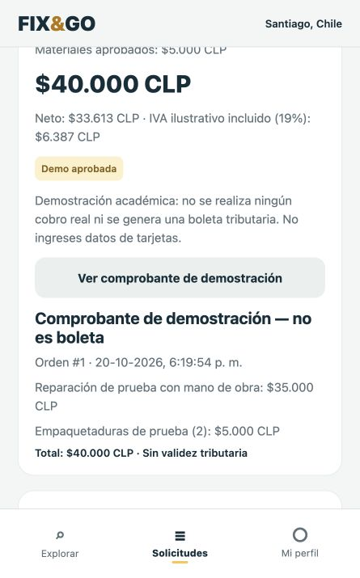

# QA del MVP — 20 de octubre de 2026

## Alcance y resultado

Se verificó la API Django y la app React Native/Expo en navegador, con una base SQLite de QA separada y dos cuentas ficticias. El resultado permite demostrar el recorrido principal con pago simulado; no certifica pagos bancarios ni producción.

| Validación | Resultado |
|---|---|
| Django `check` | Sin problemas |
| Migraciones `--check --dry-run` | Sin cambios de esquema pendientes de generar |
| Suite Django | 50 pruebas aprobadas |
| TypeScript `tsc --noEmit` | Aprobado |
| Pruebas del cliente HTTP | 8 aprobadas |
| Expo `install --check` | Dependencias compatibles |
| Exportación Expo web, iOS, Android | Los tres bundles se generaron |
| Consola de la app durante recorrido QA | Sin errores registrados |
| Revisión visual en ancho móvil | Resumen y comprobante legibles, controles utilizables |

## Recorrido comprobado desde la interfaz

1. Ingreso del cliente y carga del catálogo real de la API.
2. Solicitud dirigida a un prestador; descripción y dirección de prueba conservadas.
3. Ingreso del prestador en una segunda sesión y lectura de la nueva solicitud.
4. Cotización de $35.000, aceptación del cliente e inicio del servicio.
5. Propuesta de dos materiales de $2.500 cada uno; aprobación del cliente.
6. Actualización del total a $40.000 en ambos roles; material marcado aprobado.
7. Cierre del trabajo y confirmación del total; bloqueo de edición de materiales.
8. Pago demo rechazado, reintento aprobado y comprobante de la misma orden.
9. Mensaje del cliente visible desde la sesión del prestador tras actualizar conversación.
10. Valoración 5/5 persistida y visible en el detalle.
11. Guardado de teléfono, dirección y comuna habitual; nueva solicitud precargó la dirección guardada.

## Casos cubiertos por pruebas automáticas

Identidad, duplicados de correo, contraseñas con hash, expiración y revocación de tokens, rollback del registro, perfil reutilizable, permisos por rol/solicitud, cobertura territorial, cotizaciones y transiciones inválidas, filtros inválidos, valoraciones, materiales aprobados/rechazados, límites de cantidades/importes, total excesivo, prohibición de importes manipulados, una sola orden, reintentos, bloqueo después del checkout, permisos de chat/comprobante y simulación deshabilitada fuera de configuración explícita de desarrollo. También se verifica que el teléfono no se exponga en el catálogo y que usuarios inactivos no aparezcan allí.

Las pruebas del cliente HTTP cubren encabezados, login sin token, 401, errores por campo, respuesta no JSON, fallo de red, paginación segura de catálogos y health.

## Pendientes que no se deben presentar como aprobados

- Instalación y recorrido en teléfonos físicos iOS y Android mediante Expo Go compatible; revisar teclado, permisos de red local y recuperación al volver del segundo plano.
- Compilación nativa iOS: actualizar Xcode al requerido por SDK 57 o usar un entorno compatible. Exportar JavaScript/Hermes no prueba una compilación IPA/APK.
- Ensayo en la Wi-Fi efectiva de la presentación y en la red alternativa.
- Pruebas de carga/concurrencia sostenida y recuperación de respaldos. Las restricciones de unicidad y transacciones se probaron funcionalmente; no se afirma un benchmark de concurrencia.
- Pasarela y cuenta de comercio, cobro real, tarjetas tokenizadas, webhooks, conciliación y boleta tributaria.
- Llamadas y notificaciones push. La conversación implementada es texto y requiere actualizar manualmente.

## Repetir QA

Ejecutar los comandos del README. Para el ensayo manual usar dos cuentas ficticias, una por rol, y un prestador con categorías/comunas configuradas. Activar explícitamente el pago demo en el backend local. No usar datos de tarjetas ni información personal del equipo. La dirección ficticia y el teléfono de QA son datos sintéticos.

El prototipo HTML de `frontend/` se conserva como referencia; se revisó sintaxis y compatibilidad de paginación, pero no integra el flujo de pagos. El recorrido detallado de este informe corresponde al cliente `mobile/`.
